# fridge-note

**One shopping list for the whole home, live on everyone's phone, even in a supermarket with no signal.**

fridge-note is a shared shopping list for couples and roommates, built with Flutter for Android, iOS and the web. Several people edit the same list and see each other's changes as they happen. It works offline and syncs when the connection comes back. You invite people with a link or a QR code.

**Live demo: [sirine2907.github.io/fridge-note](https://sirine2907.github.io/fridge-note/)** (opens straight into demo mode, no sign-up)

<p align="center">
  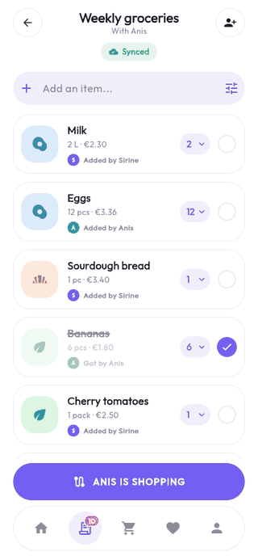
</p>

The GIF is the real web build in demo mode: "Anis" checks things off on the other phone, I check off the eggs, and the shopping trip screen picks up each change as it arrives.

## Screenshots

| Welcome | My lists | List |
|:---:|:---:|:---:|
| 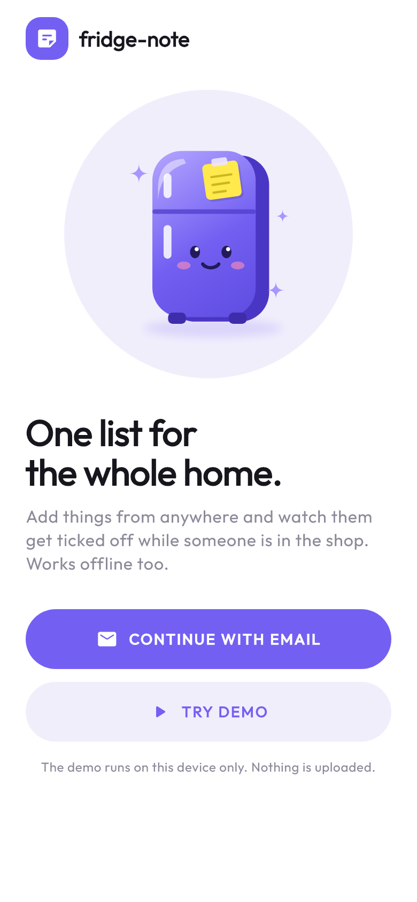 | 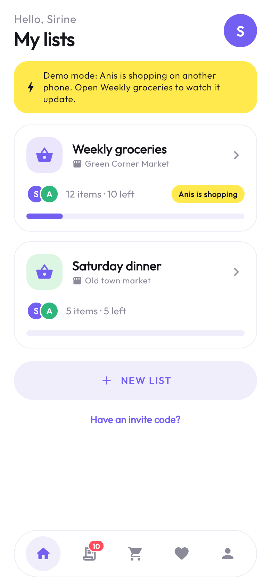 | 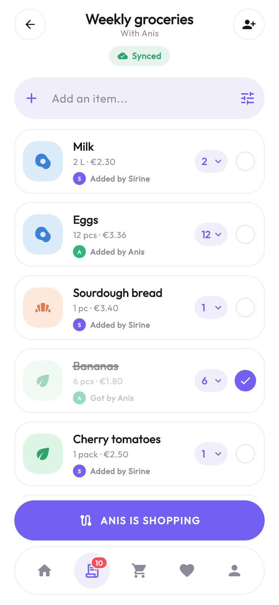 |
| **Shopping trip** | **Usuals** | **Invite** |
| 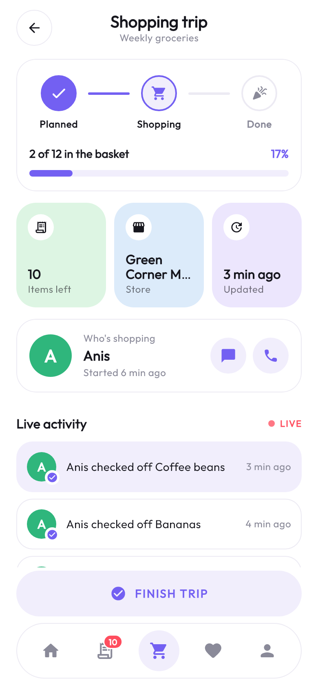 | 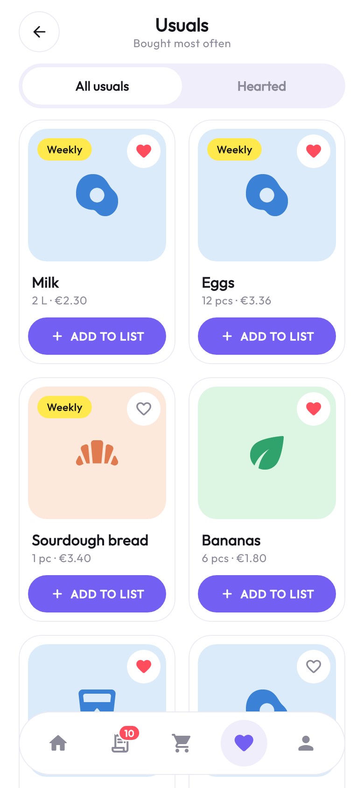 | 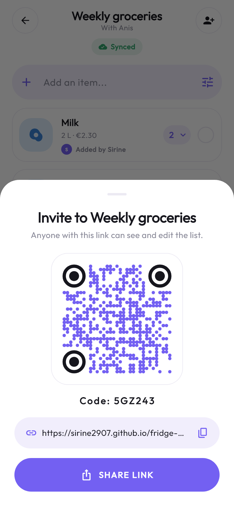 |
| **Profile** | **Empty list** | **Join from a link** |
| 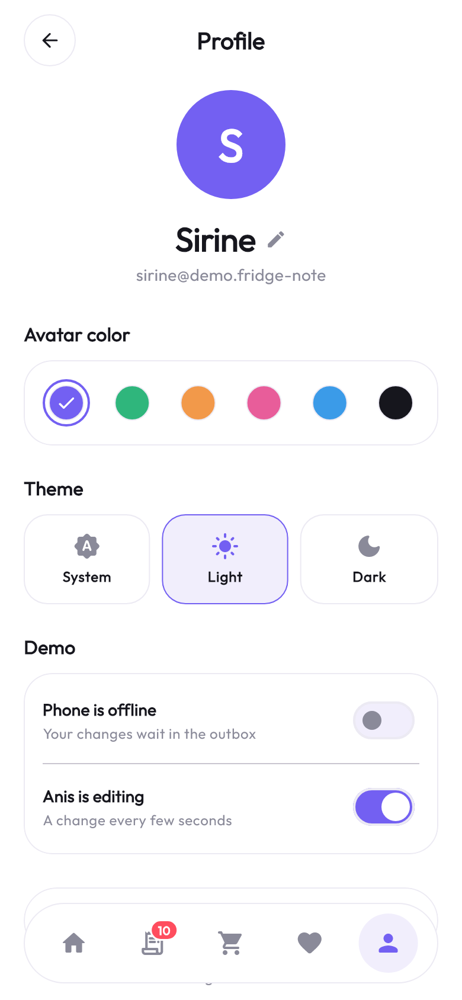 | 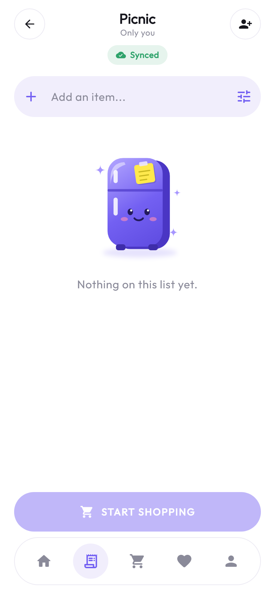 | 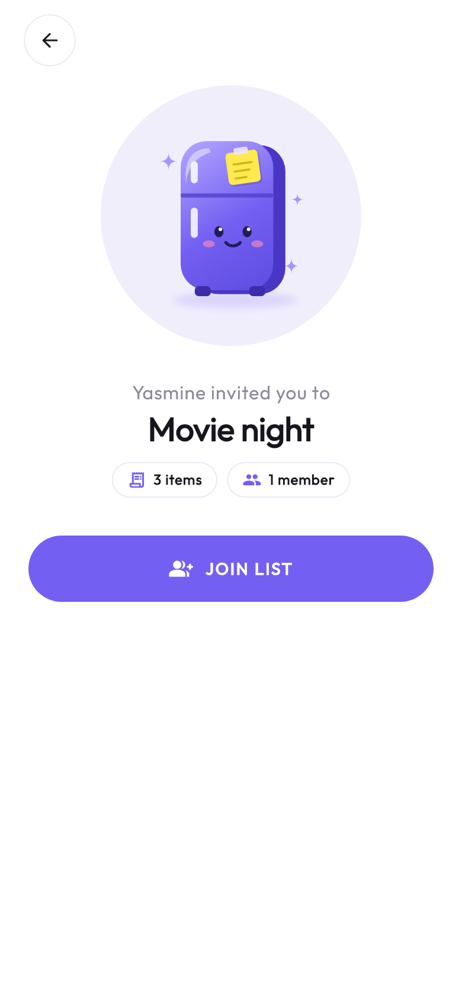 |

<details>
<summary><b>Dark mode</b></summary>

| My lists | List | Shopping trip |
|:---:|:---:|:---:|
| 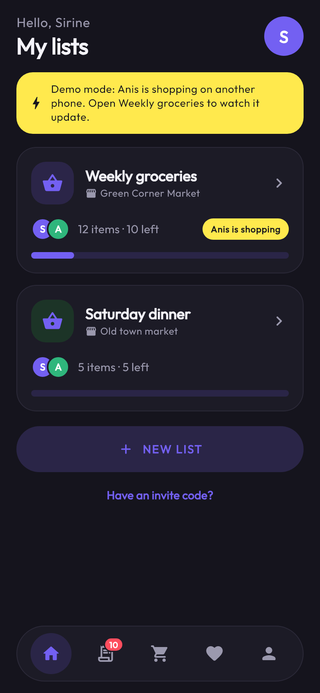 | 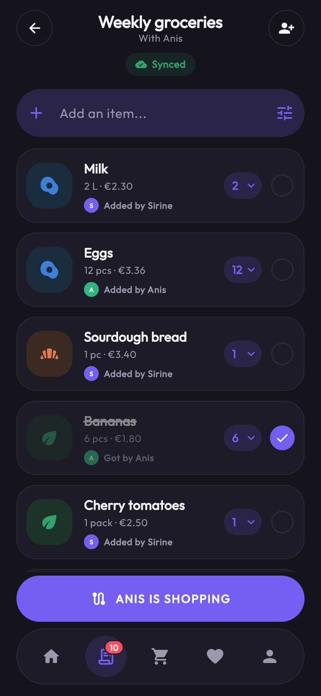 | 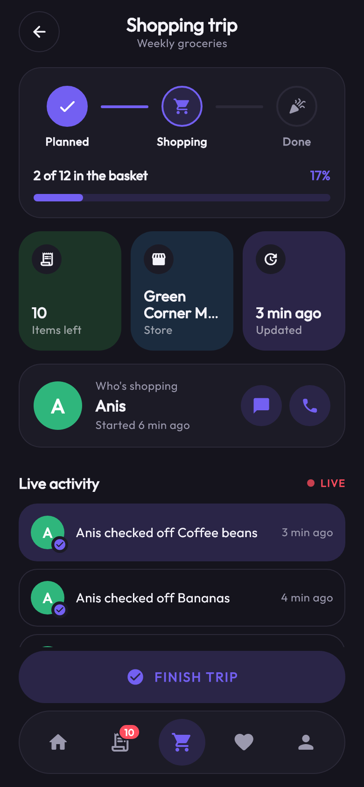 |
| **Usuals** | **Invite** | **Profile** |
| 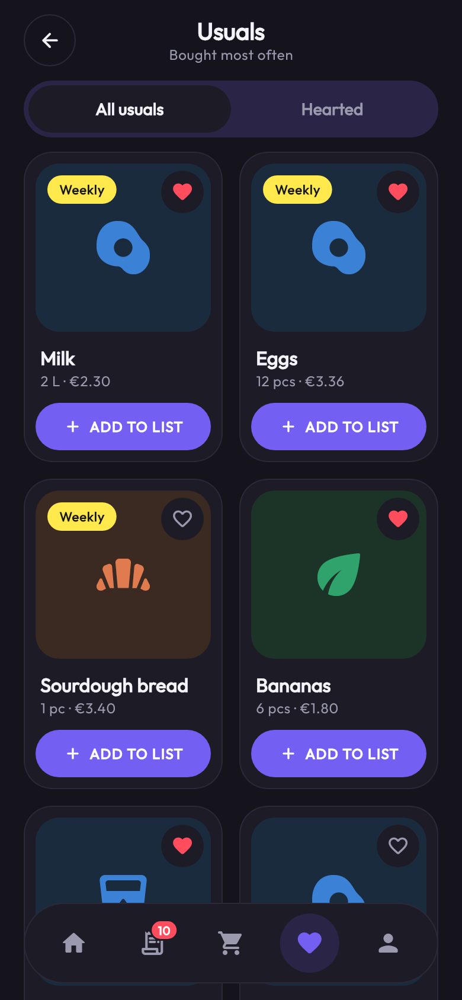 | 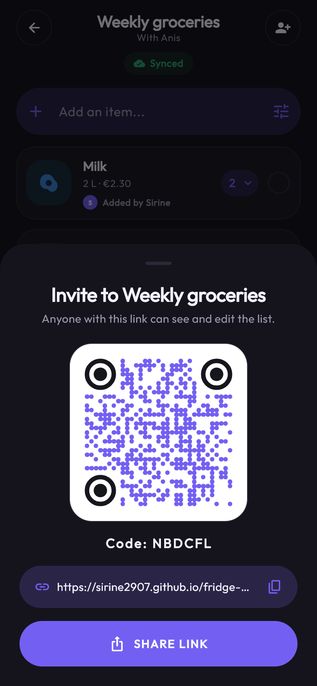 | 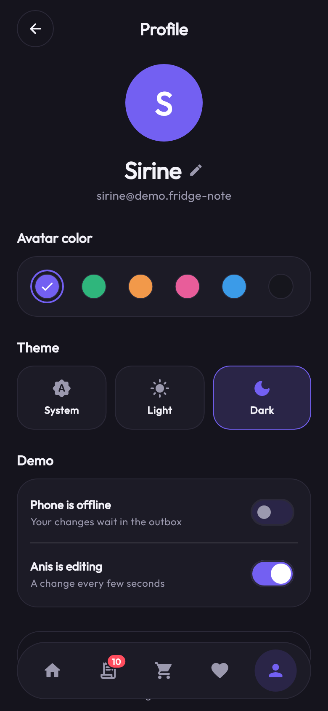 |
| **Welcome** | **Empty list** | **Join from a link** |
| 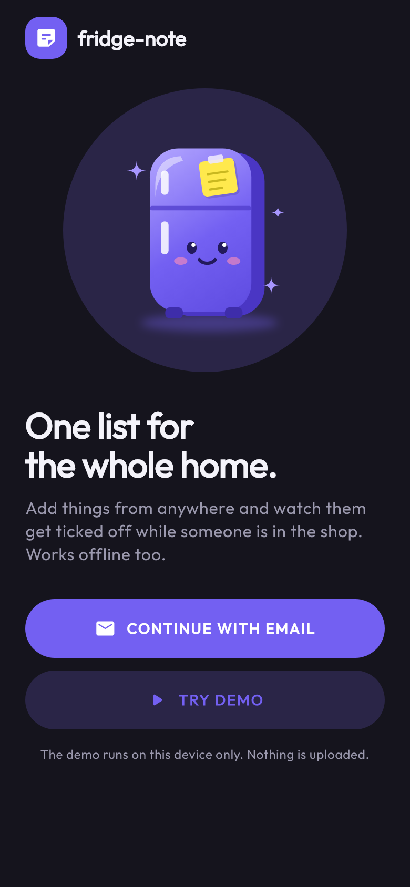 | 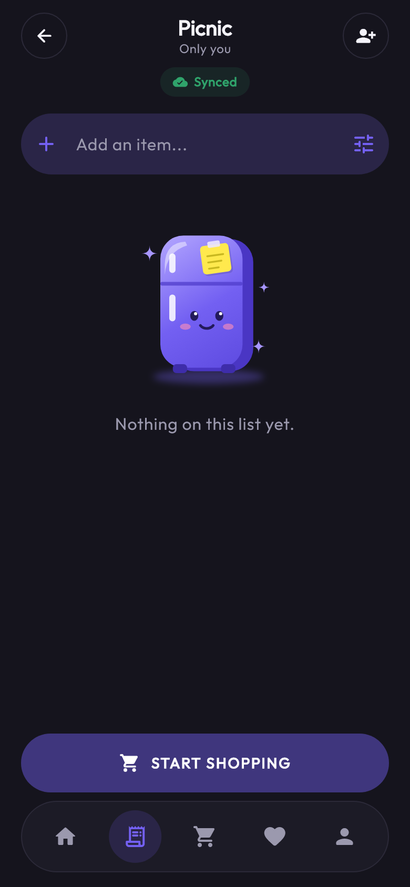 | 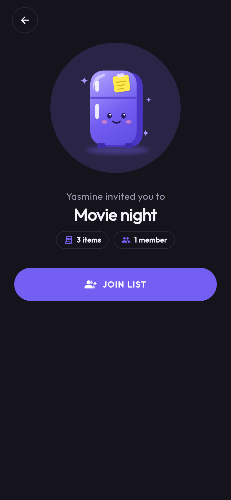 |

</details>

## Why I built it

I wanted one list that both of us can edit, that keeps working in the shop where the signal is bad, and where a check-off made offline never gets lost when the phone syncs later. It was also a good project to learn offline-first sync properly instead of just calling an API from the screen.

## Features

- **Live sync.** When someone checks off "Milk", it ticks off on the other phones within a second.
- **Offline first.** The screens only read from the local database. Changes made offline wait in an outbox and go out when the connection is back. A chip under the list title says "Synced", "2 changes waiting" or "Offline".
- **No lost check-offs.** Conflicts are solved per field, so if Anis renames an item while Sirine ticks it off, both changes survive.
- **Shopping trip.** Planned → Shopping → Done, who is in the shop, how many items are left, and a live activity feed ("Anis checked off Milk").
- **Usuals.** The things you buy most often in a grid, with a heart for favourites and one tap to add them to the list.
- **Invites.** Share a link or show a QR code. Opening `/invite/CODE` shows a preview of the list and a Join button.
- **Android home-screen widget** with the current list and how many items are left.
- **Quick add.** Type a name and press enter. The category is guessed from the name ("oat milk" gets the dairy tile). There is also a full form, a quantity dropdown, swipe to delete and drag to reorder.
- **Light and dark mode.**
- **Demo mode.** "Try demo" runs the whole app against a fake server in memory, with a pretend household (Sirine & Anis, two lists, 17 items). Anis changes something every few seconds, so you can watch the sync without an account. In Profile you can switch the phone "offline" and watch changes wait in the outbox.

## Design

White screens on a soft lavender page (`#E4E0F0`), violet (`#7360F2`) as the main color, and pastel mint, sky and lilac tiles for the item categories. Cards have 24 px corners and a 1 px border instead of shadows, and buttons are full pills. Inner screens have a round outlined back button. The five tabs sit in a floating pill-shaped bar, where the active icon gets a light violet circle and the list icon shows a red count badge. Text is set in [Outfit](https://fonts.google.com/specimen/Outfit).

The little purple fridge on the welcome and empty screens is drawn in code with a `CustomPainter` (gradients, a gloss highlight and a sticky note), so the app has no image assets. Checking an item off draws a line through the name and fades the card, and progress bars slide to their new value.

On a wide screen (the web demo on a laptop) the app is shown as a phone-sized screen in the middle of the lavender page.

## Architecture

Clean architecture with one folder per feature, each split into `data`, `domain` and `presentation`.

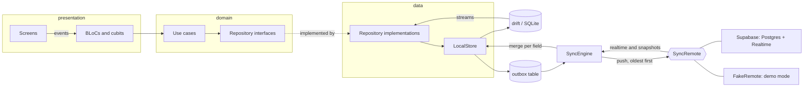

```
lib/
├── main.dart, app.dart
├── core/
│   ├── config/              Env, values from --dart-define
│   ├── database/            drift tables, in-memory and on-device connections
│   ├── sync/                RecordPatch, mergeFields, LocalClock, LocalStore, SyncEngine, SyncRemote
│   ├── supabase/            SupabaseSyncRemote
│   ├── demo/                FakeRemote, the seeded household, the pretend partner
│   ├── di/                  get_it setup and the per-session scope
│   ├── router/              go_router routes, redirects and the tab shell
│   ├── theme/               colors and the light and dark themes
│   └── widgets/             pill button, back button, nav bar, cards, illustration
└── features/
    ├── auth/                welcome, email code sign-in, session
    ├── lists/               home, list detail, items
    ├── shopping/            shopping trip
    ├── usuals/              things bought often
    ├── invite/              share sheet, join page, invite repositories
    ├── profile/             name, avatar color, theme, demo switches
    └── home_screen_widget/  keeps the Android widget up to date
```

Everything that belongs to the signed-in person (their database, the sync engine, the repositories) is registered in a get_it scope that is opened on sign-in and thrown away on sign-out. Demo mode only swaps two things in that scope: an in-memory database and `FakeRemote` instead of Supabase.

### How sync works

1. **Every change is a patch.** A patch is a few column values for one row, each with the time it was made. A check-off is `{checked: true, checked_by: me}` and nothing else.
2. **Local first.** `LocalStore.applyLocal` merges the patch into the drift database and adds it to the outbox in the same transaction. The screens listen to the database, so they update straight away, online or not.
3. **Push.** `SyncEngine` sends the outbox to the server oldest first, and only deletes an entry once the server has accepted it. If the server can't be reached it stops, shows "Offline", and tries again when the connection comes back.
4. **Merge on the server.** The Postgres function `apply_patch()` merges the patch column by column with last-write-wins on each column.
5. **Pull.** Realtime sends changed rows to every phone, and `LocalStore.applyRemote` merges them with the same rule. After being offline the engine also pulls a full snapshot, in case it missed realtime events.

Because conflicts are handled per column, a toggle can only be overwritten by a newer change to the toggle itself. Phone clocks can be a little off, so `LocalClock` never stamps a change lower than the newest time it has received: a toggle you make right after seeing someone else's change is always newer than that change. When two times are exactly equal, both sides pick the bigger JSON value, so `true` wins and every phone ends up with the same row.

## Tech stack

| | |
|---|---|
| Framework | Flutter 3.38 (Android, iOS, web) |
| State | flutter_bloc, equatable |
| Dependency injection | get_it, with a scope per signed-in session |
| Routing | go_router, deep links `/invite/:code` |
| Local database | drift (SQLite, sqlite3.wasm on the web) |
| Backend | Supabase: Auth with email codes, Postgres with row level security, Realtime |
| Other | home_widget, qr_flutter, share_plus, connectivity_plus, google_fonts |
| Tests | flutter_test, bloc_test, mocktail |

## Run it

### Demo, no setup

```bash
git clone https://github.com/sirine2907/fridge-note.git
cd fridge-note
flutter pub get
flutter run
```

Tap **Try demo** on the welcome screen. The web build skips the welcome screen and opens the demo straight away:

```bash
flutter run -d chrome
```

In the demo, **Have an invite code?** on the home screen with `MOVIE24` joins a third list from Yasmine.

### With Supabase

1. Create a project on [supabase.com](https://supabase.com).
2. Open the SQL editor and run [`supabase/schema.sql`](supabase/schema.sql). It creates the tables, row level security, the `apply_patch()` merge function and the invite functions, and turns on Realtime for the tables.
3. In **Authentication → Emails → Magic Link**, add `{{ .Token }}` to the template so the email contains the 6 digit code.
4. Copy `.env.example` to `.env` and fill in the project URL and the publishable key (**Project Settings → API**).
5. Run:

```bash
flutter run --dart-define-from-file=.env
```

The keys are only read from `--dart-define`. `.env` is in `.gitignore`, so real keys never end up in the repo.

### Android widget

Long-press the home screen, open **Widgets** and drag **fridge-note** onto it. It shows the list you have open in the app.

## Tests

```bash
flutter test --exclude-tags screenshots
```

- `test/core`: the merge rule, the clock, `LocalStore`, and the sync engine against the fake server (offline outbox, catching up after a reconnect, a change the server refuses, toggles against renames and slow clocks), plus the redirects and the widget texts.
- `test/features`: use cases, BLoCs and cubits, widget tests for the list screen, and tests that run the whole demo app and check that a check-off travels both ways.

The screenshots above are golden tests that render each screen in light and dark mode:

```bash
flutter test test/screenshots --update-goldens
```

The demo GIF is recorded from the web build with Playwright, then the frames are joined with Pillow:

```bash
flutter build web --release --base-href /fridge-note/ --dart-define=DEMO=true
node tool/record_demo.cjs
python tool/make_demo_gif.py
```

`supabase/schema.sql` was checked on a local PostgreSQL 16 with small stand-ins for Supabase's `auth.uid()` and roles: merging, defaults, ties, row level security between two users, and the invite and join flow.

GitHub Actions runs `flutter analyze` and the tests on every push, and every push to `main` builds the web demo and deploys it to GitHub Pages.

## License

MIT, see [LICENSE](LICENSE). The bundled Outfit font is under the SIL Open Font License, see [assets/fonts/OFL.txt](assets/fonts/OFL.txt).
